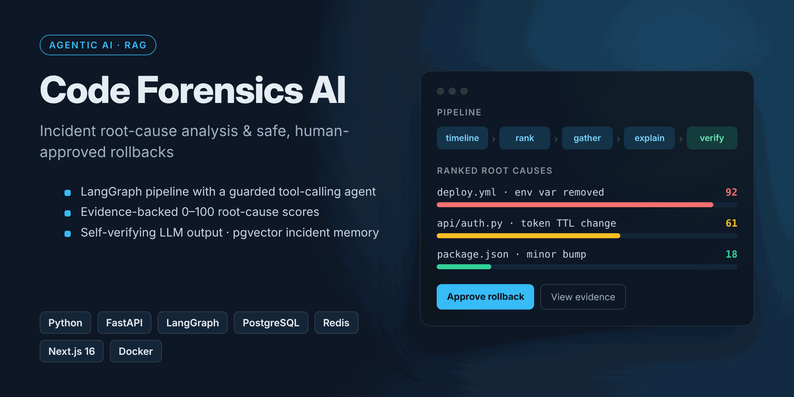
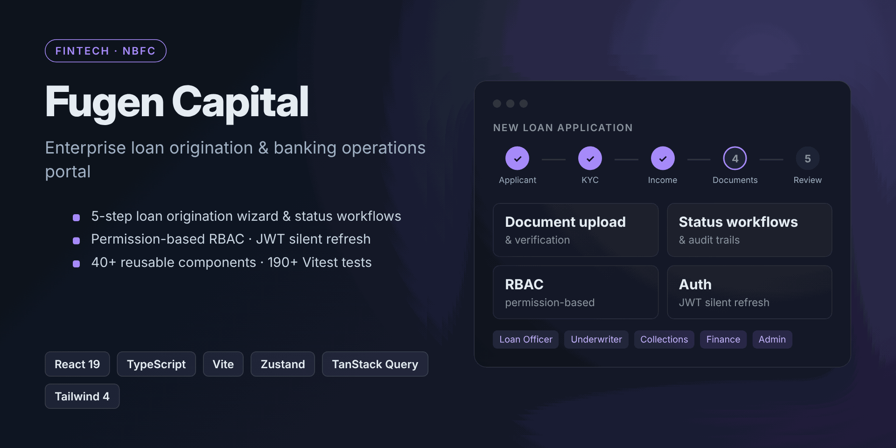
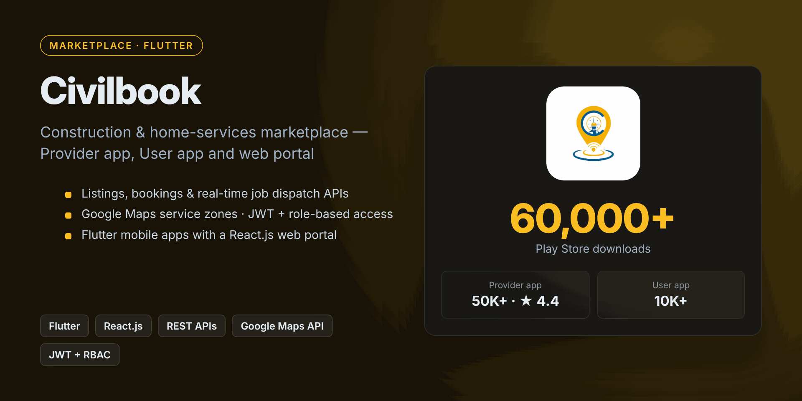

# Hi, I'm Sreenu Chandaka 👋
**Full Stack Developer (MERN + AI)** | **Generative AI · RAG · LangGraph · Agentic AI** | **Flutter** | **Fintech / NBFC**

📍 Vijayawada, India · Open to relocate (on-site / hybrid / remote)

Full Stack Developer and AI Engineer with **3.5 years** of experience building production web and mobile products, with a strong focus on **backend and AI**. Senior developer and core member of a 5-person team, mentoring 3 junior developers through planning, code reviews and releases.

---

# 🛠️ **Core Skills**

| **Category** | **Technologies** |
|--------------------------|-------------------------------------------------------|
| **Backend** | 🖥️ Node.js, Express.js, Python, FastAPI, REST APIs, Microservices, WebSockets |
| **AI / GenAI** | 🤖 Generative AI, LLMs, RAG, LangGraph, Agentic AI, Tool Calling, Structured Output (Pydantic) |
| **Frontend** | 🎨 React.js (19), Next.js, TypeScript, Redux, Zustand, TanStack Query, Tailwind CSS |
| **Mobile** | 📱 Flutter, Firebase (FCM, Firestore) |
| **Data** | 🗃️ MongoDB, PostgreSQL, MySQL, Redis, pgvector |
| **Cloud & DevOps** | ☁️ AWS, Docker, GitHub Actions CI/CD |
| **Security** | 🔐 JWT (silent refresh), RBAC, Zod validation |
| **Testing** | ✅ pytest, Vitest, Jest, React Testing Library, Playwright |

---

### 🚀 **What I've Shipped**

#### 🔍 [Code Forensics AI](https://github.com/Sreenu-Chandaka/Code-Forensics-AI) — Agentic Incident Root-Cause Analysis & Safe Rollback

Detects CI/deployment failures from GitHub webhooks, ranks root causes with evidence-backed 0–100 scores, explains them with an LLM and offers safe, human-approved rollbacks.
- LangGraph pipeline (timeline → rank → gather → explain → verify) with a tool-calling agent: read-only tools, path allowlists, call budgets, prompt-injection fencing, audit logs
- Self-verifying AI: Pydantic-validated JSON output; explanations citing files outside the evidence are auto-rewritten
- RAG incident memory on pgvector (HNSW); works with Gemini or any OpenAI-compatible LLM
- `Python` `FastAPI` `PostgreSQL` `Redis` `Next.js 16` `React 19` `Docker` · 182 pytest tests + Playwright E2E

#### 🏦 Fugen Capital — Enterprise NBFC Loan & Banking Operations Portal

Loan origination and operations portal for loan officers, underwriters, collections, finance and admin teams.
- REST APIs for loan applications, document upload & verification, status workflows and audit trails
- Permission-based RBAC, JWT with silent refresh and request queueing, Zod-validated API responses
- 40+ reusable components, 5-step loan origination wizard, 190+ Vitest tests
- `React 19` `TypeScript` `Vite` `Zustand` `TanStack Query` `Tailwind CSS 4`

#### 🏗️ Civilbook — Construction & Home-Services Marketplace (60,000+ Play Store downloads)

Two-sided marketplace: [Provider app](https://play.google.com/store/apps/details?id=com.civilbook.civilbookprovider) (50K+, ⭐ 4.4) and [User app](https://play.google.com/store/apps/details?id=com.civilbook.civilbookuser) (10K+), built in Flutter with a React.js web portal.
- Backend APIs for listings, bookings, availability, service areas and real-time job dispatch
- Google Maps API for delivery zones; JWT + role-based access for providers and users

#### More
- **SUKI ERP** — Offline-first ERP (finance, HRMS, inventory, projects) with React + IndexedDB sync, PostgreSQL/MySQL microservices and a FastAPI anomaly-detection service
- **Salestable** — Sales CRM with AI forecasting & lead scoring (FastAPI), multi-role access and custom dashboards
- **Peepul-Agri** — AI crop-disease detection from photos, with sensor data ingestion on MongoDB
- **Real-time chat backend** — WebSockets (Socket.IO/STOMP) for 500+ concurrent users at sub-100ms latency

---

### 📈 **Impact in Numbers**

| | |
|---|---|
| 👥 **10,000+** active users at **99.5%** uptime | 📲 **60,000+** Play Store downloads (Civilbook) |
| ⚡ **30%** lower dashboard latency via WebSockets | 💬 **500+** concurrent chat users, **<100ms** latency |
| 🔔 **35%** higher engagement via FCM push | ✅ **370+** automated tests running in CI |

---

### 💼 **Experience**

| Company | Role | Period |
|---------|------|--------|
| **Fugen Webtech** · Vijayawada | Full Stack Developer (MERN + AI) | Jun 2025 – Present |
| **Suki Software Solutions** · Chennai | Software Developer (Full Stack) | Aug 2024 – May 2025 |
| **Noki Technologies** · Hyderabad | Software Developer (Full Stack) | Aug 2023 – Jul 2024 |
| **Orotron** · Hyderabad | Backend Developer Intern | Feb 2023 – Jul 2023 |

🎓 **Rajiv Gandhi University of Knowledge Technologies (RGUKT), Srikakulam**

---

# 🌟 **Open to Roles & Collaboration in:**

### 🖥️ **Full Stack / MERN Development**
- End-to-end systems with React.js / Next.js frontends and Node.js / FastAPI backends.
- Clean architecture, REST APIs, JWT/RBAC and microservices.

### 🤖 **AI Engineering**
- Agentic AI with LangGraph, tool-calling LLMs, RAG on pgvector and structured, verifiable outputs.

### 📱 **Cross-Platform Mobile**
- Flutter apps for Android & iOS backed by shared REST APIs and Firebase.

### ⚡ **Real-Time Systems**
- Live dashboards, chat, job dispatch and notifications with WebSockets and Socket.IO.

---

### 🤝 **Let's Build Together**

🌐 Explore my [Portfolio Website](https://sreenu-chandaka.github.io/portfolio/)
📬 Reach out via [Email](mailto:chandakasreenu0@gmail.com) or [LinkedIn](https://www.linkedin.com/in/sreenuchandaka/)
✍️ I write about full-stack, Flutter and system design on Medium
💡 Open to Full Stack / MERN and AI engineering roles — available to join immediately!

---

**"The art of engineering lies in transforming complex challenges into elegant solutions."**
*— Sreenu Chandaka*
